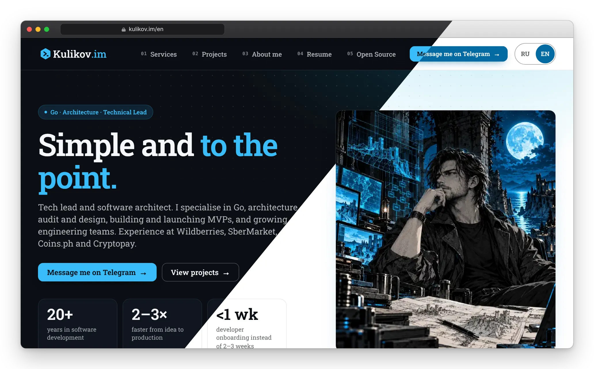

<div align="center">

# kulikov.im

**A personal site engineered like a product: fast, accessible, bilingual, tested on every push.**

[](https://github.com/im-kulikov/kulikov.im/actions/workflows/ci.yaml)


[](https://codecov.io/gh/im-kulikov/kulikov.im)

[**kulikov.im**](https://kulikov.im) · [**kulikov.im/en**](https://kulikov.im/en/) · [Русская версия README](README.ru.md)



</div>

## Why look at this repo

I am a tech lead and software architect (Go, platform engineering, 20+ years in software). This is my own site, and I built it the way I ask teams to build production services: small surface, no magic, every promise backed by a check that runs in CI.

| | |
|---|---|
| **Fast** | Lighthouse (mobile, lab): **97** performance, **100** accessibility, best practices and SEO. Layout shift **0**, ~9 KB of CSS over the wire, JS under 1 KB, no framework. |
| **Self-hosted** | Fonts (Roboto Slab, subset to latin + cyrillic, ~33 KB), icons and logo all ship from the site. No CDN, no analytics, no trackers, no cookie banner. |
| **Bilingual** | Russian and English from one set of pages. Language switch with a remembered choice, `hreflang` + `x-default`, a sitemap per language. |
| **Accessible** | Contrast is verified in a real browser on every page in light and dark theme, 44 px touch targets, skip link, no horizontal overflow from 320 px up. |
| **Reproducible** | Two builds of the same sources are byte-identical; the build fails on any template warning. |
| **Safe pipeline** | Pull requests can only test, never deploy. Actions are pinned to commit SHAs, the Hugo binary is checksum-verified, runners are pinned, Dependabot is on. |

## What is inside

- **Content as data.** Pages are short Markdown files with shortcodes; the sections (services, projects, resume, features) are YAML blocks rendered by a handful of partials. No copy-pasted HTML.
- **One source for two languages.** Texts live next to each other as `{ru, en}` pairs and one partial (`i18n/resolve.html`) picks the right one; UI strings are in `src/i18n`. A test fails if a pair loses a language.
- **Theme-aware by construction.** Dark and light mode follow the system. The logo is a single inline SVG painted by the theme variables; the favicon is one SVG that switches colours, with a real `.ico`, an Apple touch icon and maskable PWA icons rendered from it.
- **Images with a budget.** Responsive WebP through Hugo's image pipeline; tests cap every file (150 KB), the total (3 MB) and the social preview (1200×630, 300 KB).
- **A design system, not a template.** Tailwind v4 plus a small component layer in `src/assets/css/custom.css`; cards, chips, hero, language switch and menu are all there.

## Quality gates

`npm test` builds the site once and runs checks over the result:

- **Data schemas** for every YAML block, in both languages.
- **SEO**: unique titles and descriptions, canonical equals `og:url`, Open Graph/Twitter tags, reciprocal `hreflang`, sitemap lists exactly the indexable pages.
- **Links and CSS**: every `#fragment` link has a target, no links to alias or `/index.html` URLs, external links use https with `rel=noopener`, every class used in the HTML has a CSS rule, a size budget for the stylesheet, `prefers-reduced-motion` and a print stylesheet exist.
- **Images, icons, manifest**: budgets, valid ICO, maskable icon, correct PNG sizes.
- **Pipeline**: workflow permissions, pinned actions and runners, verified Hugo download.
- **Determinism**: two builds, identical bytes.

`npm run test:coverage` runs the same browser tests against an unminified, source-mapped build and reports line coverage of the site's JavaScript to [Codecov](https://codecov.io/gh/im-kulikov/kulikov.im) (currently every line; Hugo templates, YAML and CSS have no line coverage, their checks are the tests above).

`npm run lighthouse` runs Lighthouse on every built page (both languages; 404s and redirects excluded) with one Chrome and fails when a score or a metric (LCP, TBT, CLS) crosses its budget; CI runs it in a separate job and posts the results to the job summary and as a pull request comment. Run `node tests/build.mjs` first.

`npm run test:e2e` drives Chromium (Playwright) through the built site: overflow at five widths, WCAG contrast in both themes, the language switch and the remembered choice, grid layout.

CI runs both on every pull request; a merge to `main` deploys to GitHub Pages, and a monthly rebuild keeps the footer year honest.

## Run it

You need [Hugo extended](https://gohugo.io/installation/) (version in `.hugo-version`) and Node.js (version in `.nvmrc`).

```bash
npm ci
hugo server            # http://localhost:1313
```

```bash
hugo --gc --minify     # production build into build/public
npm test               # builds, then checks (set HUGO_BIN if hugo is not on PATH)
CHROME_PATH=/path/to/chrome npm run test:e2e
node tools/build-icons.mjs   # re-render the raster icons after editing favicon.svg
node tools/build-previews.mjs   # re-render docs/preview-*.webp (README image: MacBook and iPhone, dark/light diagonal split) from the built site
```

## Repository map

```text
config/_default/      Hugo config: languages, params, menus, output formats
src/content/          pages (index.md / index.en.md) and their YAML blocks
src/layouts/          templates: partials/blocks, components, i18n resolver, SEO
src/assets/           CSS (Tailwind v4), images, fonts, logo and icon sources
src/i18n/             UI strings (ru, en)
tests/                node:test suites; tests/e2e for the browser checks
tools/                helper scripts (icons, README screenshots)
.github/              CI workflow, shared setup action, Dependabot
```

## Work with me

Looking for a tech lead or an architect for a platform, a Go service or an engineering team? Let's talk.

- Site: [kulikov.im](https://kulikov.im) · Resume: [kulikov.im/en/resume.html](https://kulikov.im/en/resume.html)
- Telegram: [@li_si_qing](https://t.me/li_si_qing) · Email: [im@kulikov.im](mailto:im@kulikov.im)
- GitHub: [@im-kulikov](https://github.com/im-kulikov)
