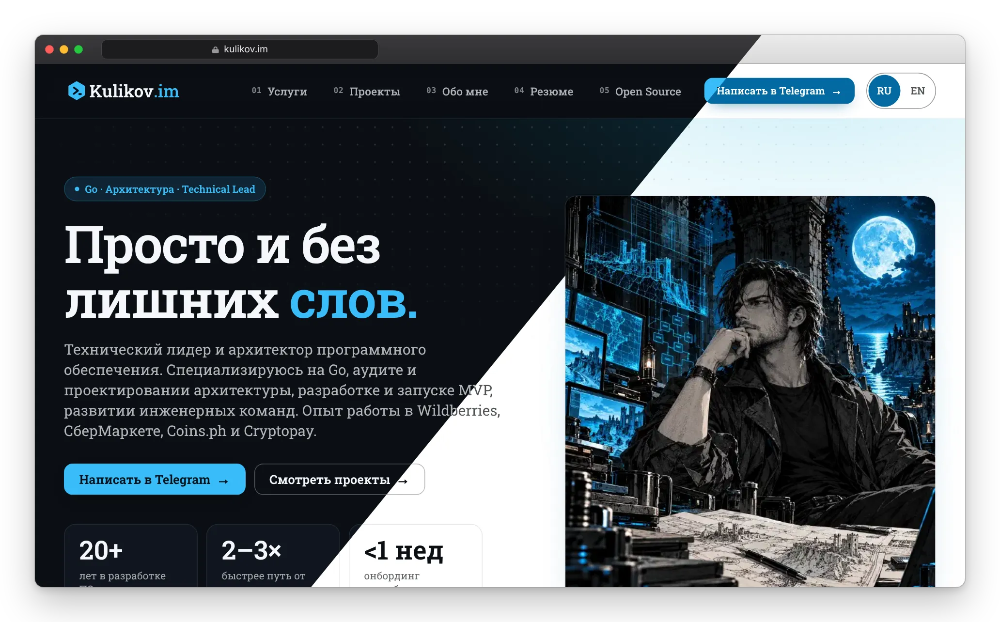

<div align="center">

# kulikov.im

**Личный сайт, сделанный как продукт: быстрый, доступный, на двух языках и проверяемый при каждом пуше.**

[](https://github.com/im-kulikov/kulikov.im/actions/workflows/ci.yaml)


[](https://codecov.io/gh/im-kulikov/kulikov.im)

[**kulikov.im**](https://kulikov.im) · [**kulikov.im/en**](https://kulikov.im/en/) · [English README](README.md)



</div>

## Зачем смотреть этот репозиторий

Я технический лидер и архитектор ПО (Go, платформенная разработка, 20+ лет в индустрии). Это мой собственный сайт, и я собрал его так, как прошу команды собирать продакшен-сервисы: маленькая поверхность, никакой магии, каждое обещание подтверждено проверкой в CI.

| | |
|---|---|
| **Быстрый** | Lighthouse (мобильный, лабораторный): **97** производительность, **100** доступность, лучшие практики и SEO. Сдвиг макета **0**, ~9 КБ CSS по сети, JS меньше 1 КБ, без фреймворков. |
| **Всё своё** | Шрифты (Roboto Slab, подмножество латиница + кириллица, ~33 КБ), иконки и логотип отдаются с самого сайта. Без CDN, аналитики, трекеров и cookie-баннера. |
| **Два языка** | Русский и английский из одного набора страниц. Переключатель с запоминанием выбора, `hreflang` и `x-default`, свой sitemap на каждый язык. |
| **Доступный** | Контраст проверяется в настоящем браузере на каждой странице в светлой и тёмной теме, цели касания 44 px, ссылка «перейти к содержимому», нет горизонтальной прокрутки от 320 px. |
| **Воспроизводимый** | Две сборки из одних исходников побайтно одинаковы; сборка падает на любом предупреждении шаблонов. |
| **Безопасный конвейер** | Pull request может только тестировать, деплоить не может. Действия закреплены по SHA коммитов, бинарь Hugo проверяется по контрольной сумме, раннеры закреплены, Dependabot включён. |

## Что внутри

- **Контент как данные.** Страницы — короткие Markdown-файлы с шорткодами; разделы (услуги, проекты, резюме, преимущества) — YAML-блоки, которые рисуют несколько partial-шаблонов. Никакого скопированного HTML.
- **Один источник на два языка.** Тексты лежат рядом парами `{ru, en}`, нужный выбирает один partial (`i18n/resolve.html`); строки интерфейса в `src/i18n`. Тест падает, если у пары пропал язык.
- **Темы по построению.** Тёмная и светлая тема следуют системе. Логотип — один встроенный SVG, цвета ему задают переменные темы; фавикон — один SVG, меняющий цвета, плюс настоящий `.ico`, иконка для Apple и maskable-иконки для PWA, отрисованные из него.
- **Картинки с бюджетом.** Адаптивный WebP через конвейер изображений Hugo; тесты ограничивают каждый файл (150 КБ), сумму (3 МБ) и превью для соцсетей (1200×630, 300 КБ).
- **Дизайн-система, а не шаблон.** Tailwind v4 и небольшой слой компонентов в `src/assets/css/custom.css`: карточки, чипы, hero, переключатель языка, меню.

## Проверки качества

`npm test` собирает сайт один раз и проверяет результат:

- **Схемы данных** для каждого YAML-блока, на обоих языках.
- **SEO**: уникальные заголовки и описания, canonical равен `og:url`, теги Open Graph и Twitter, взаимные `hreflang`, sitemap содержит ровно индексируемые страницы.
- **Ссылки и CSS**: у каждой `#фрагмент`-ссылки есть цель, нет ссылок на алиасы и `/index.html`, внешние ссылки по https с `rel=noopener`, у каждого класса в HTML есть CSS-правило, есть бюджет на размер стилей, учтены `prefers-reduced-motion` и печать.
- **Картинки, иконки, манифест**: бюджеты, валидный ICO, maskable-иконка, правильные размеры PNG.
- **Конвейер**: права workflow, закреплённые действия и раннеры, проверяемая загрузка Hugo.
- **Детерминизм**: две сборки с одинаковыми байтами.

`npm run test:coverage` запускает те же браузерные тесты на несжатой сборке с source map и отправляет в [Codecov](https://codecov.io/gh/im-kulikov/kulikov.im) покрытие строк JavaScript сайта (сейчас все строки; у шаблонов Hugo, YAML и CSS построчного покрытия нет, их проверяют тесты выше).

`npm run lighthouse` прогоняет Lighthouse по всем собранным страницам (оба языка, без 404 и редиректов) в одном Chrome и падает, если оценка или метрика (LCP, TBT, CLS) выходит за бюджет; в CI это отдельная джоба, результаты она пишет в сводку и комментарий к PR. Перед запуском выполните `node tests/build.mjs`.

`npm run test:e2e` прогоняет собранный сайт через Chromium (Playwright): переполнение по ширине на пяти размерах, контраст WCAG в обеих темах, переключатель языка и запоминание выбора, раскладка сетки.

CI запускает оба набора на каждом pull request; слияние в `main` деплоит на GitHub Pages, а ежемесячная пересборка не даёт устареть году в подвале.

## Запуск

Нужны [Hugo extended](https://gohugo.io/installation/) (версия в `.hugo-version`) и Node.js (версия в `.nvmrc`).

```bash
npm ci
hugo server            # http://localhost:1313
```

```bash
hugo --gc --minify     # боевая сборка в build/public
npm test               # сборка и проверки (если hugo не в PATH, задайте HUGO_BIN)
CHROME_PATH=/path/to/chrome npm run test:e2e
node tools/build-icons.mjs   # перерисовать растровые иконки после правки favicon.svg
node tools/build-previews.mjs   # перерисовать docs/preview-*.webp (картинка для README: MacBook и iPhone, диагональ тёмная/светлая тема) из собранного сайта
```

## Карта репозитория

```text
config/_default/      конфиг Hugo: языки, параметры, меню, форматы вывода
src/content/          страницы (index.md / index.en.md) и их YAML-блоки
src/layouts/          шаблоны: partials/blocks, компоненты, i18n-резолвер, SEO
src/assets/           CSS (Tailwind v4), картинки, шрифты, исходники логотипа и иконок
src/i18n/             строки интерфейса (ru, en)
tests/                наборы node:test; tests/e2e для проверок в браузере
tools/                вспомогательные скрипты (иконки, скриншоты для README)
.github/              CI, общий setup-action, Dependabot
```

## Давайте работать вместе

Ищете техлида или архитектора для платформы, Go-сервиса или инженерной команды? Давайте поговорим.

- Сайт: [kulikov.im](https://kulikov.im) · Резюме: [kulikov.im/resume.html](https://kulikov.im/resume.html)
- Telegram: [@li_si_qing](https://t.me/li_si_qing) · Почта: [im@kulikov.im](mailto:im@kulikov.im)
- GitHub: [@im-kulikov](https://github.com/im-kulikov)
